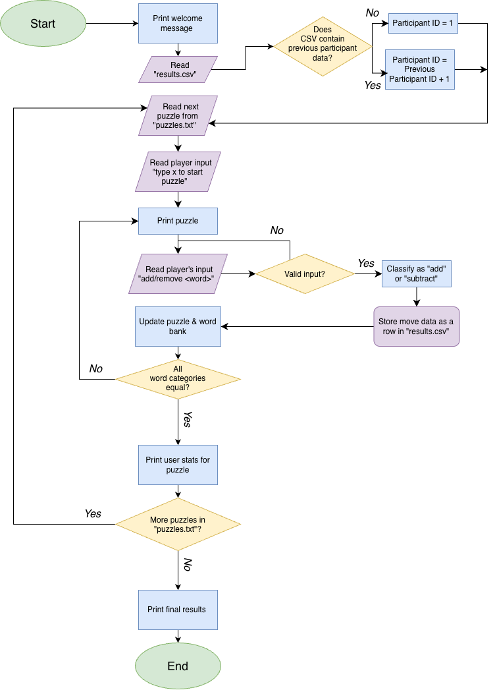

# addition-bias-game
A language-based terminal puzzle game that tests whether humans and LLMs share the same bias toward adding over subtracting.

## The Problem

This past week, I listened to a Freakonomics Radio episode interviewing Leidy Klotz, author of "Subtract: The Untapped Science of Less", which discusses studies showing that humans are biased toward adding rather than subtracting to solve problems, even when subtracting is clearly more efficient. This made me wonder whether AI models, trained on human-written data, inherit this bias or simply find the most efficient solution, as we traditionally expect computers to do. I want to pursue the intersection of AI and cognition, and this question sits right at it.

## The Idea

I plan to build a language-based puzzle game in Java, played in the terminal, where each puzzle is designed so that subtracting is the more efficient solution, and the program tracks and logs in a CSV file whether the player solves it by adding or subtracting. After getting some data by testing it on a few friends, I’ll give the same puzzles to an LLM and score its answers the same way to compare the results.

## How It Works

Each puzzle gives the player a list of words in different categories and a rule (for example, every category must have the same number of words). The player types commands like `add kiwi` or `remove red`. Every move is classified as an addition or a subtraction and logged to a CSV. Each puzzle is designed so that removing words reaches the goal in fewer moves than adding them.

## MVP Scope

- Load a puzzle from a text file and display it with its rule in the terminal
- Read player commands (`add <word>` / `remove <word>`), validate them, and check when the puzzle is solved
- Classify each move as an add or a subtract
- Log results to a CSV with an anonymous participant ID

Eisenhower Matrix: [Eisenhower Matrix](Eisenhower_Matrix.pdf)

## Tech Stack

- **Language:** Java (requires Java 11 or newer)
- **Input:** `Scanner`
- **File I/O:** `BufferedReader` / `PrintWriter`
- **Puzzle storage:** `.txt` file; puzzles and fields separated by marker strings, each puzzle containing ID, rule, word list and word bank, with words stored as `word:category`
- **Results storage:** `.csv` file, one row per move: `participant ID, puzzle ID, move #, word, add/subtract`
- - **Tools:** Git/GitHub, draw.io, IntelliJ
- -**No external libraries are needed for the MVP.** Following are schedule specific:
-  `java.net.http.HttpClient` for API requests and Gson for JSON parsing
- **LLM API:** considering gemini-2.5-flash, llama-3.3-70b-versatile, or OpenRouter; I'll test from the terminal before choosing. The API key will be stored in a local config file listed in `.gitignore`, so it's never committed.

## Build Plan

- [x] 1. Set up the repo, folder structure (`src/` for Java files, `puzzles/` for puzzle files, `data/` for CSV output), README, matrix and diagram
- [ ] 2. Add one puzzle to the puzzle file, then read and print it in the terminal
- [ ] 3. Read a user command, validate it, update the word list and reprint
- [ ] 4. Classify each move as add or subtract, and log it to the CSV
- [ ] 5. End the puzzle when word categories are equal, and print add/subtract stats to the terminal
- [ ] 6. Add more puzzles and run a full session under one participant ID (previous ID from the CSV + 1)
- [ ] 7. Edge-case pass (missing file, bad input, quitting mid-task), plus run instructions and example output. **MVP complete.**
- [ ] 8. Feature branch: LLM participant. Send the puzzle as a prompt, parse the reply, and run it through the same classifier
- [ ] 9. Feature branch: human vs. AI comparison output, then merge

## Roadmap (Future Plans)

- [ ] LLM participant via API
- [ ] Human vs. AI comparison report
- [ ] End-of-session summary report
- [ ] Color-coded terminal output (ANSI codes)
- [ ] Timing and improvement metrics

## Setup

## Background

## Author

Anusha Sharma, [GitHub](https://github.com/anushasharmanj)